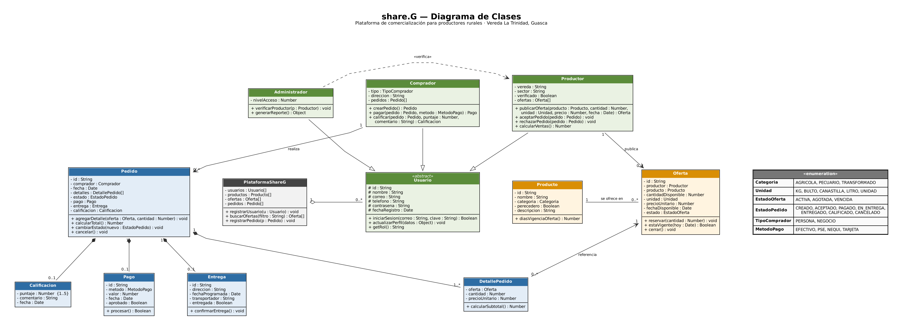

# share.G 🌱

Plataforma de comercialización que conecta a los productores rurales de la **vereda La Trinidad, sector San Francisco (Guasca, Cundinamarca)** directamente con compradores, reduciendo la dependencia de intermediarios.

Proyecto de Ingeniería de Software — Universidad de La Salle.

## Sitio web

La página de la plataforma está en `index.html`, `css/`, `js/` e `img/`.

## Diagrama de clases



## Estructura

```
index.html, css/, js/, img/   # Sitio web de la plataforma
modelo/
├── package.json
├── docs/                   # Diagrama de clases (PNG, SVG, fuente .dot)
└── src/
    ├── main.js                 # Demostración del flujo completo
    ├── index.js                # Exporta todas las clases
    └── modelo/
        ├── enums.js            # Categoria, Unidad, EstadoOferta, EstadoPedido, TipoComprador, MetodoPago
        ├── Usuario.js          # Clase abstracta
        ├── Productor.js        # extends Usuario
        ├── Comprador.js        # extends Usuario
        ├── Administrador.js    # extends Usuario
        ├── Producto.js
        ├── Oferta.js
        ├── Pedido.js           # Máquina de estados del pedido
        ├── DetallePedido.js
        ├── Pago.js
        ├── Entrega.js
        ├── Calificacion.js
        └── PlataformaShareG.js
```

## Relaciones implementadas

| Relación | Tipo | Multiplicidad |
|---|---|---|
| Productor, Comprador, Administrador → Usuario | Herencia | — |
| PlataformaShareG ◇— Usuario | Agregación | 1 — 0..* |
| Productor — Oferta | Asociación | 1 — 0..* |
| Producto — Oferta | Asociación | 1 — 0..* |
| Comprador — Pedido | Asociación | 1 — 0..* |
| Pedido ◆— DetallePedido | Composición | 1 — 1..* |
| Pedido ◆— Pago / Entrega / Calificacion | Composición | 1 — 0..1 |
| DetallePedido — Oferta | Asociación | 0..* — 1 |
| Administrador ┄> Productor | Dependencia «verifica» | — |

## Reglas de negocio

- **RN1:** solo un productor verificado puede publicar ofertas.
- **RN2:** toda oferta tiene producto, cantidad, unidad, precio y fecha.
- **RN3:** un pedido no puede superar la cantidad disponible.
- **RN4:** solo se califica un pedido entregado.
- **RN5:** los productos perecederos tienen menor vigencia de oferta.

## Ejecutar

Requiere Node.js 18 o superior.

```bash
cd modelo
npm start
```

## Equipo

- Daniel Esteban Castaño Calvo — Scrum Master
- Miguel Vega — Product Owner
