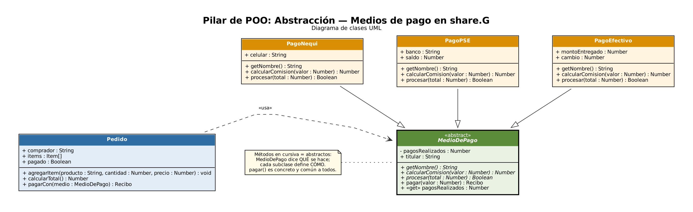

# Pilar de POO: Abstracción — share.G

**Abstraer** es quedarse con lo esencial de un objeto (*qué hace*) y ocultar los detalles (*cómo lo hace*).

En share.G un comprador puede pagar su pedido con **Nequi**, **PSE** o **efectivo contra entrega**. Para el `Pedido` todos son lo mismo: *un medio de pago que sabe pagar*. Los detalles de cada medio (validar el celular, debitar el banco o calcular el cambio) quedan ocultos dentro de cada clase.

## Diagrama UML



## Cómo se aplica la abstracción en JavaScript

| Concepto | Implementación |
|---|---|
| Clase abstracta | `MedioDePago`: el constructor lanza un error si se hace `new MedioDePago()` (`new.target`) |
| Métodos abstractos | `getNombre()`, `calcularComision()` y `procesar()` lanzan un error si la subclase no los implementa |
| Método concreto común | `pagar(valor)` es el mismo algoritmo para todos y usa los métodos abstractos |
| Ocultamiento | `#pagosRealizados` es un campo privado con un getter de solo lectura |
| Uso de la abstracción | `Pedido.pagarCon(medio : MedioDePago)` no conoce las clases concretas |

## Estructura

```
abstraccion/
├── package.json
├── docs/                   # Diagrama UML (PNG, SVG y fuente .dot)
└── src/
    ├── main.js             # Demostración
    ├── Pedido.js           # Usa la abstracción
    └── pagos/
        ├── MedioDePago.js  # «abstract»
        ├── PagoNequi.js
        ├── PagoPSE.js
        └── PagoEfectivo.js
```

## Ejecutar

```bash
cd abstraccion
npm start
```

Salida:

```
❌ MedioDePago es abstracta: use PagoNequi, PagoPSE o PagoEfectivo
🧾 Pedido de Restaurante El Fogón — subtotal $ 151.000
   ✅ Nequi: comisión $ 0 → total $ 151.000
🧾 Pedido de Tienda La Cosecha — subtotal $ 151.000
   ✅ PSE (Bancolombia): comisión $ 2.265 → total $ 153.265
🧾 Pedido de Doña Marta — subtotal $ 151.000
   ✅ Efectivo contra entrega: comisión $ 2.000 → total $ 153.000
❌ PagoIncompleto debe implementar calcularComision()
```

## Integrantes

- Daniel Esteban Castaño Calvo
- Miguel Vega
- Daniel Cortes
- Dilan Correa
- Tomás
